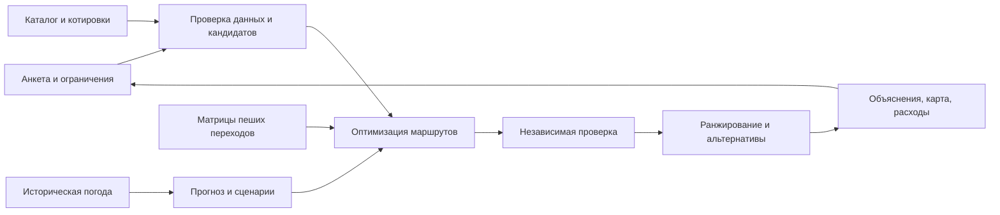

# СППР выбора направления и маршрута путешествия — проект и implementation plan

Этапы 5–8: реализованы маршрутизация, риски, рекомендации и интерфейс; технические результаты — [отчет](reports/STAGES_5_8.md). По уточнению пользователя вместо заявления о проведенном UX-исследовании подготовлены [руководство и сценарии его проверки](docs/USER_GUIDE.md); [описание внутреннего устройства](docs/INTERNALS.md) содержит ссылки на код.

Ход реализации первых четырех этапов и фактические ограничения: [отчет](reports/STAGES_1_4.md). Текст ниже сохраняет исходные проектные решения; изменения и экспериментальные результаты описаны в отчете.

**Результат системы:** до трех выполнимых вариантов «направление + транспорт + проживание + маршрут по дням», с оценкой соответствия предпочтениям, полной стоимостью, рисками и объяснением компромиссов. Лицо, принимающее решение (ЛПР), — путешественник; окончательный выбор остается за ним.

Числа в демонстрациях ниже синтетические, а не реальные цены, прогнозы или экспериментальные результаты готового MVP. Арифметика ранжирования и пример оптимизации проверены скриптом `examples/verify_design.py`; результат сохранен в `examples/design_demo_results.json`. Эта оговорка относится к исходным расчетным примерам. Фактическое состояние кода, данных и обучения описано в отчете реализации; приложение относится к последующим этапам.

## 1. Границы MVP и сценарий решения

Для первой версии принимаются конкретные ограничения:

- один совершеннолетний путешественник, отправление из Москвы;
- шесть направлений: Санкт-Петербург, Казань, Нижний Новгород, Ярославль, Калининград, Сочи;
- 2–5 календарных дней, один город и одно место проживания на поездку;
- по 20–30 проверенных объектов на город, включая крытые и открытые; всего 120–180 объектов;
- прогулочные маршруты внутри города; трансферы аэропорт/вокзал — отдельные проверенные по времени и стоимости участки;
- 1–2 доступных транспортных пакета туда-обратно и 1–2 варианта проживания для каждого поддерживаемого набора дат;
- рубли, местные часовые пояса, бюджет на всю поездку; переезды, ночи, питание и входные билеты обязательны в смете;
- для защиты подготовлены три набора дат разных сезонов; произвольные даты поддерживаются при наличии соответствующих котировок. За пределами покрытия система показывает недостающие данные;
- бронирование, оплата, визовые рекомендации, групповые предпочтения и маршруты между несколькими городами не входят в MVP.

Это ограничение сохраняет все семь обязательных функций и делает проверку данных и оптимизацию выполнимыми для учебного проекта. Система не позиционируется как сервис с актуальными предложениями по всему миру.

**Ввод:** даты и допустимые часы выезда/возвращения, бюджет B, интересы, желательная температура, допустимая ходьба в день, обязательные/исключенные объекты, приоритеты критериев и терпимость к риску. По умолчанию — до 6 часов активностей в день, 30 минут на обед, не менее 10 минут запаса перед привязанными ко времени событиями. Значения редактируемые.

**Вывод:** сравнительные карточки, карта, расписание по дням, структура расходов, интервалы оценок, объяснение ранга, причины исключения альтернатив, резервный вариант и анализ «что изменится, если…».

**Ключевой принцип:** направление оценивается после построения маршрута. Город с большим числом достопримечательностей не получает высокий балл за места, которые невозможно посетить.

## 2. Данные и их качество

| Данные | Конкретный источник / способ получения | Обработка и назначение |
|---|---|---|
| Координаты, категории объектов, пешеходная сеть | OpenStreetMap, ограниченная выгрузка по шести городам | Дедупликация; ручная проверка 120–180 объектов; атрибуция OSM |
| Время работы, билеты, ограничения посещения | Официальные сайты объектов, ручной CSV-импорт с URL и датой проверки | Интервалы по датам, выходные, время последнего входа; исключения важнее типового расписания |
| Длительность посещения, тематические теги | Курируемая экспертная разметка | Диапазон длительности, источник оценки, отсутствие притворной точности |
| Стоимость транспорта и проживания | Датированные предложения поставщиков, введенные вручную пользователем/редактором | Цена на нужные даты, условия тарифа, вместимость, время выезда/прибытия, доступность; автоматическое бронирование не требуется |
| Питание и трансферы | Настраиваемые дневные нормы и проверенные предложения | Отдельные статьи бюджета и интервалы неопределенности |
| Историческая погода | Open-Meteo Historical Weather API, фиксированная модель ERA5, 2015–2025 | Суточные максимум температуры, осадки и ветер; единый источник для сопоставимости |
| Ближайшая погода | Open-Meteo Forecast API при доступном горизонте | Сохранить время выпуска, горизонт и модель; явно отделять от долгосрочной сезонной оценки |
| Время/длина перемещений | Локальный OSRM с профилем foot и ограниченными выгрузками OSM | Матрица для объектов и базовых точек; кешировать; недостижимые пары исключать |

Open-Meteo предоставляет исторические модельные данные, включая реанализ; это не обязательно прямые наблюдения метеостанций. Бесплатный доступ предназначен для некоммерческого использования, условия проверяются перед развертыванием. Источники: [исторические данные](https://open-meteo.com/en/docs/historical-weather-api), [условия сервиса](https://open-meteo.com/en/pricing).

OSRM Table возвращает матрицы длительности маршрутов; профиль зависит от подготовки графа. Нельзя использовать автомобильный публичный сервер и просто подписать его результат как пешеходный. Для воспроизводимой демонстрации подготовленные матрицы и геометрия сохраняются локально. Источники: [OSRM API](https://project-osrm.org/docs/v5.24.0/api/), [атрибуция и лицензия OSM](https://www.openstreetmap.org/copyright).

**Контракт качества.** Каждая запись содержит `source_url`, `observed_at`, `valid_from/to`, `data_kind` (наблюдение, реанализ, котировка, экспертная оценка, синтетика), `confidence_note`, единицы и версию. Котировки старше установленного TTL, например 24 часов, требуют подтверждения; часы работы — проверки перед поездкой. TTL является правилом приложения, а не гарантией поставщика.

Неизвестная доступность не означает «доступно». Объект без расписания исключается из подтвержденного маршрута либо показывается как неподтвержденная опция. Нулевая цена допустима только при подтвержденном бесплатном входе. Недостающая котировка не заменяется выдуманной. Для демонстрационного снимка дата актуальности видна постоянно.

**Интерпретация:** ЛПР видит, какая часть предложения подтверждена источниками, какая рассчитана и какую нужно уточнить перед покупкой.

## 3. Критерии, предпочтения и многокритериальная модель

### 3.1. Сначала ограничения, затем предпочтения

Жесткие ограничения: даты, возвращение вовремя, бюджет в базовом сценарии, открытость объектов, допустимая ходьба, обязательные объекты, совместимость транспортных и гостиничных предложений. Любое запрещенное пользователем условие не компенсируется высоким баллом по другим критериям.

Дополнительно пользователь выбирает требуемую долю успешных сценариев: например, 90% или 95%. Это требование к используемой сценарной модели, а не обещание реального мира.

### 3.2. Четыре итоговых критерия

| Критерий | Измерение | Полезность 0…1 | Почему выбран |
|---|---|---|---|
| Соответствие интересам I | Полезность реально включенных объектов | Насыщение по темам, формула ниже | Персонализация, защита от набора однотипных объектов |
| Экономичность K | Ожидаемая полная стоимость C, руб. | `clip((B−E[C])/(B−C_good),0,1)` | Понятная ценовая уступка и единая смета |
| Погодный комфорт W | Средняя доля дней, подходящих под заявленные температурные/погодные предпочтения | Среднее по дням и сценариям индикатора комфортных условий | Учитывает даты, а не абстрактный климат города |
| Удобство F | Переезды туда-обратно и ходьба в маршруте | `1−0.5·clip(T_transfer/T_bad,0,1)−0.5·clip(L_walk/L_bad,0,1)` | Отражает утомительность и потерю отпускного времени |

`clip(x,0,1)=min(1,max(0,x))`. Опорные значения задаются до сравнения: `C_good` — стоимость, ниже которой дополнительная экономия уже несущественна; по умолчанию 0.6B. Для удобства `T_bad=24 часа` на всю поездку, `L_bad=D·L_max`, где D — число дней, L_max — дневной предел ходьбы. Все опоры видны пользователю. Необходимо `0≤C_good<B`.

При изменении списка городов опоры не пересчитываются: это исключает изменение полезности существующего варианта только из-за появления нового кандидата. Время и расходы одновременно входят в ограничения и предпочтения осознанно: сначала соблюдается предел, затем выбирается более комфортный или дешевый вариант внутри предела.

### 3.3. Интересы и веса

Темы: культура, история, природа, гастрономия. Пользователь распределяет интересы `p_k≥0`, `Σp_k=1`. Объект i получает экспертный тематический вектор `a_ik∈[0,1]`, `Σ_k a_ik=1`. При полном посещении его вклад в тему равен `a_ik`; сокращение посещения ниже минимальной длительности запрещено.

Для маршрута R:

`I(R)=Σ_k p_k · min(Σ_{i∈R} a_ik / Q_k, 1)`.

По умолчанию `Q_k=D`: насыщение наступает после D эквивалентных посещений данной темы. Q фиксируется до оптимизации и одинаково для всех направлений. Теги объекта не увеличивают суммарную ценность сами по себе. Формула не вознаграждает бесконечное добавление музеев после удовлетворения интереса к культуре.

Итоговая модель — аддитивная многокритериальная полезность:

`U(R)=w_I I(R)+w_K K(R)+w_W W(R)+w_F F(R)`, `w_j≥0`, `Σw_j=1`.

Начальные веса: `(0.45,0.25,0.15,0.15)`. Для настройки используется swing weighting: пользователь распределяет 100 баллов между улучшениями каждого критерия от худшего опорного уровня до лучшего. Так веса относятся к конкретным диапазонам, а не к расплывчатой «важности». Если сумма введенных весов равна нулю, форма просит исправить ввод.

**Почему эта модель:** разложение итогового балла на четыре слагаемых легко проверить и объяснить; фиксированные шкалы позволяют сравнивать направления и маршруты одинаково. Предположение — приемлемость компенсации между мягкими критериями; недопустимые компромиссы оформляются ограничениями. AHP добавляет попарные сравнения и проверку согласованности без необходимости для четырех критериев; TOPSIS сложнее объяснить через вклад признаков и зависит от способа выбора опор. В MVP они не нужны.

### 3.4. Проверяемый пример ранжирования

Синтетический пример: B=45 тыс. руб., `C_good=25 тыс. руб.`; все три кандидата условно прошли ограничения. I, W, F уже рассчитаны для соответствующих маршрутов.

| Направление | E[C], тыс. руб. | I | K | W | F | U, исходные веса | U, веса (0.70,0.10,0.10,0.10) |
|---|---:|---:|---:|---:|---:|---:|---:|
| Казань | 35 | 0.90 | 0.50 | 0.60 | 0.70 | 0.7250 | **0.8100** |
| Нижний Новгород | 30 | 0.80 | 0.75 | 0.65 | 0.80 | **0.7650** | 0.7800 |
| Сочи | 32 | 0.70 | 0.65 | 0.90 | 0.60 | 0.7025 | 0.7050 |

Объяснение преимущества Нижнего Новгорода над Казанью: `−0.045` по интересам, `+0.0625` по стоимости, `+0.0075` по погоде и `+0.015` по удобству; итог `+0.0400`. При усилении интересов лидирует Казань. Это демонстрирует зависимость решения от предпочтений, но не доказывает качество рекомендаций на реальных поездках.

При линейном переходе между двумя показанными наборами весов лидеры меняются примерно на 57.1% пути: разность баллов меняется с +0.04 до −0.03. В приложении анализ чувствительности сопровождается повторной оптимизацией маршрутов; этот пример относится к фиксированным маршрутам.

## 4. Прогноз по историческим данным

**Выбранный показатель:** максимальная суточная температура воздуха в городе. Он имеет доступную историю, измеримую ошибку и прямую связь с погодными предпочтениями. Прогнозировать туристическую цену без достаточной однородной истории было бы необоснованно.

**Базовая модель:** средняя температура для календарного дня в окне ±15 дней по прошлым годам, доступным на момент прогноза.

**Кандидат:** отдельная по городу сезонная Ridge-регрессия:

`T_hat(t)=β0+β1·trend(t)+Σ_{h=1..3}[b_h sin(2πh·doy/365.25)+c_h cos(2πh·doy/365.25)]`.

Модель обучается по истории, имеет мало параметров и не требует неизвестных будущих признаков. Коэффициент регуляризации выбирается на временной валидации; признаки стандартизируются только по обучающей выборке. [Документация Ridge](https://scikit-learn.org/stable/modules/generated/sklearn.linear_model.Ridge.html).

**Проверка:** обучение 2015–2021 → валидация 2022; расширенное обучение до 2022 → валидация 2023; после выбора настроек обучение до 2023 → калибровка интервалов на 2024; независимый тест 2025. Все прогнозы в тесте используют только ранее доступные данные. Случайное перемешивание временного ряда запрещено; схема соответствует принципу [временного разделения](https://scikit-learn.org/stable/modules/generated/sklearn.model_selection.TimeSeriesSplit.html).

Метрики: MAE в °C, skill=`1−MAE_model/MAE_baseline`, покрытие и ширина 80%-го предиктивного интервала, отдельно по городам и сезонам. Желательный критерий выбора Ridge: улучшение MAE минимум на 5% относительно baseline без существенного ухудшения калибровки; если улучшение не подтверждается, в MVP остается обученная сезонная базовая модель. Это полноценный прогноз по историческим данным, а не неудача требования.

**Неопределенность:** использовать последовательные блоки ошибок калибровки длиной поездки, подобранные по сезону, а не независимый шум по дням. Температурный блок центрируется относительно сезонного прогноза; осадки и ветер берутся из того же исторического блока. Проверить сохранение зависимости температуры, дождя и ветра. Интервалы и вероятности остаются эмпирическими оценками.

**Связь с решением:** для каждого дня оценить долю сценариев, в которых температура попадает в пользовательский диапазон, осадки и ветер не превышают его порогов. Среднее дает W. Учитываются именно заявленные предпочтения; например, комфортная максимальная температура сама по себе не означает комфорт в каждый час суток.

Для поездки в ближайшие дни приложение использует доступный оперативный прогноз; сезонная модель служит резервом и долгосрочной оценкой. На дальних датах интерфейс пишет «сезонная оценка», а не «точная погода». Ошибку оперативного прогноза нельзя измерять по архиву фактически реализовавшейся погоды вместо исторического прогноза: для такой оценки нужны данные выпусков и горизонтов. [Различия архивов Open-Meteo](https://open-meteo.com/en/docs/historical-forecast-api).

В MVP итоговый отчет обязательно содержит график факта/прогноза и ошибок, результаты baseline и выбранной модели. Значения MAE и skill до обучения не назначаются заранее.

## 5. Неопределенность и риск

Разделяются три вида неизвестности:

1. **Погода:** эмпирические сезонные блоки / оперативный прогноз с обоснованной оценкой ошибки.
2. **Цена и время:** при наличии повторных наблюдений — эмпирические изменения; до накопления истории — явно экспертные диапазоны, например треугольное распределение цены `(min,mode,max)` и множитель времени переходов. Конкретные параметры задаются отдельно для каждой статьи, а не произвольным процентом на всю поездку.
3. **Доступность:** подтвержденное закрытие исключает объект; неподтвержденная доступность не получает автоматически вероятность 0.95. Для нее используются отдельные стресс-сценарии закрытия и резервные маршруты, без выдачи частоты сценариев за реальную вероятность.

В сценариях сохраняются зависимости: общий множитель удорожания затрагивает связанные статьи, дождь может одновременно ухудшать погодный комфорт и увеличивать время переходов. Номинальная стоимость и риск не должны рассчитываться на несовместимых предположениях.

Для оптимизации использовать S=100 равновероятных сценариев при фиксированном seed; для независимой проверки — 1000 новых сценариев. Для смешанной экспертно-эмпирической модели результат подписывается «доля успешных сценариев при принятых предположениях».

Событие успеха — одновременно `полная стоимость≤B`, `расписание выполнимо`, `возвращение вовремя`. Требование:

`(1/S) Σ_s 1{успех(R,s)} ≥ 1−α`, по умолчанию `α=0.10`.

Совместная проверка важна: отдельные 90% для денег и времени не дают 90% совместной выполнимости. Аналогично сумма квантилей отдельных расходов не равна квантилю общей стоимости. C50/C90 рассчитываются после суммирования расходов внутри каждого сценария.

На независимой выборке показываются доля успеха и 95%-й интервал Уилсона. Для отметки «устойчивый по модели» нижняя граница должна быть не меньше выбранного порога. Если проверка не пройдена — пересчитать с более строгим плановым запасом и проверить на новой независимой выборке либо оставить статус «риск выше порога»; успешную оценочную выборку нельзя подбирать повторными попытками без учета этой процедуры.

**Синтетическая иллюстрация:** 920 успешных сценариев из 1000 — это 92% по модели, нижняя граница интервала примерно 90.2%; такой вариант проходит порог 90%. Вариант с 840/1000 не проходит, даже если средняя цена ниже бюджета. Это не гарантия доступности при бронировании.

Для неподтвержденных закрытий отдельная таблица: «закрылся объект X → заменен Y → дополнительные расходы → потеря полезности». Резерв считается новым маршрутом и вновь проверяется; это условная стратегия действий, а не незаметная замена при оценке основного маршрута.

## 6. Оптимальный маршрут

**Постановка:** многодневная задача выбора и упорядочивания посещений с временными окнами, бюджетом и сценарными ограничениями (вариант team orienteering with time windows). Нужно выбирать подмножество объектов, поэтому обычная задача коммивояжера с обязательным посещением всех точек не соответствует задаче.

**Решатель:** OR-Tools CP-SAT. Небольшой каталог позволяет явно задать бюджет, дни, окна, обязательные посещения и сценарии; инструмент возвращает статус и оценку границы оптимума. Это удобнее сложной эвристики с неочевидным соблюдением ограничений. Все величины масштабируются до целых: минуты, рубли с округлением расходов вверх, полезность до 10 000 единиц. [Документация CP-SAT](https://developers.google.com/optimization/cp/cp_solver).

Для каждого города и каждой совместимой пары «транспортный пакет + проживание» решается отдельная задача с одинаковой U. Сравниваются все шесть городов, без предварительного отсева по привлекательности.

Переменные:

- `y_id∈{0,1}` — посещение объекта i в день d;
- `x_ijd∈{0,1}` — переход из i в j в день d;
- `t_id` — плановое время начала посещения;
- `t_ids` — начало посещения в сценарии s при том же составе и порядке;
- `z_s∈{0,1}` — сценарий может нарушить ограничения денег/времени;
- вспомогательные переменные насыщения интересов, стоимости и удобства.

Основные ограничения:

1. `Σ_d y_id≤1`; для обязательных объектов — равенство 1.
2. Входящая и исходящая степень посещенного объекта равны y_id. Каждый дневной путь имеет заданный старт и конец. День без посещений допускается, если пользователь не задал минимум.
3. Отдельные стартовый и конечный узлы позволяют корректно возвращаться в ту же гостиницу. Первый/последний день привязаны к времени прибытия/отъезда и трансферам; ночи считаются по фактическому транспортному пакету.
4. `x_ijd=1 ⇒ t_jd≥t_id+duration_i+travel_ij`; если y_id=1, все посещение находится внутри выбранного интервала работы. Несколько интервалов работы — отдельный выбор окна. Положительное время дуг и посещений исключает подциклы; нулевые дуги требуют явных порядковых ограничений.
5. Обед — обязательный 30-минутный узел в допустимом интервале; суммарная активность, ожидание и переходы укладываются в дневное окно. Ограничения ходьбы проверяются по длине сети, а не по прямой.
6. Полная стоимость = транспорт туда-обратно + проживание за все ночи + питание + трансферы + выбранные входные билеты. Базовый сценарий обязан укладываться в B.
7. Для каждого s при z_s=0 повторяются временные и бюджетные ограничения с параметрами сценария; `Σ_s z_s≤floor(αS)`. Порядок посещений фиксирован, допустим сдвиг фактического начала и ожидание. Плановое расписание показывается отдельно от такого запаса гибкости.

Критерий — максимизация U. Для фиксированного города W постоянен; остальные компоненты зависят от маршрута. Функции насыщения и отсечения реализуются целочисленными min/max-ограничениями. Рейтинг всей поездки и целевая функция решателя используют одни и те же определения, иначе система могла бы построить маршрут, неоптимальный по собственному итоговому баллу.

После решения независимый валидатор повторно вычисляет расписание, окна, расходы и сценарные успехи по исходным данным, не доверяя только переменным решателя.

**Статусы:** OPTIMAL означает доказанную оптимальность в пределах выбранного каталога, сценариев и точности целочисленной модели при нулевом допуске разрыва; FEASIBLE — найден допустимый маршрут без доказательства оптимальности. Показывать objective, best_bound и относительный gap. UNKNOWN не означает, что решения нет; INFEASIBLE означает доказанную несовместимость именно заданной модели. [Статусы решателя](https://github.com/google/or-tools/blob/stable/ortools/sat/docs/troubleshooting.md).

На задачу выделяется до 10 секунд, весь запрос — целевой предел 60 секунд с кешем, который нужно измерить. Если время превышается, интерфейс показывает готовые результаты и статус остальных; пределы регулируются по нагрузочному эксперименту. Уменьшение каталога или сценариев должно быть отражено в метаданных, а не скрыто.

### Небольшой точный пример

Один день, 330 минут, бюджет на билеты 2000 руб., обед 30 минут. Все объекты открыты весь горизонт. Точки лежат на условной прямой; гостиница в позиции 0; переход занимает `10·|position_i−position_j|` минут.

| Объект | Позиция | Посещение, мин | Билет, руб. | Полезность |
|---|---:|---:|---:|---:|
| A, музей | 1 | 120 | 1200 | 9 |
| B, галерея | 2 | 90 | 800 | 8 |
| C, парк | 3 | 60 | 0 | 6 |
| D, удаленная площадка | 10 | 90 | 400 | 10 |

Для наглядности здесь оптимизируется только сумма полезности посещений, остальные критерии зафиксированы. Жадный выбор по наибольшей индивидуальной полезности берет D: 320 минут, 400 руб., полезность 10; добавить остальные объекты уже нельзя. Полный перебор 64 непустых упорядоченных маршрутов находит A→B: 280 минут, 2000 руб., полезность 17. Рост полезности 70% относится только к этому примеру и этому baseline.

**Интерпретация:** самая интересная отдельная точка может дать менее интересную поездку из-за удаленности. У маршрута A→B остается 50 минут временного запаса, но нет запаса бюджета на билеты. Выбор зависит от того, ценит ли ЛПР дополнительные посещения выше экономии; полная модель учитывает оба фактора.

## 7. Рекомендательный механизм и несколько решений

Выбирается контентный механизм: интересы пользователя сопоставляются с тематикой посещений, после чего рекомендации ограничиваются выполнимыми маршрутами. Он работает для нового пользователя без истории кликов. Коллаборативная фильтрация в MVP не оправдана отсутствием достаточной истории пользователей.

Последовательность:

1. Проверить вход и данные, отфильтровать несовместимые транспортные/гостиничные пакеты.
2. Получить погодные оценки, сценарии и матрицы переходов.
3. Максимизировать U для каждой совместимой комбинации.
4. Для дополнительных компромиссов решить задачи минимальной стоимости и максимального удобства при `U≥U_best−δ`, по умолчанию δ=0.05. Если диапазон дает один вариант, не расширять его молча.
5. Объединить кандидатов, удалить доминируемые по I,K,W,F и риску; это Парето-фронт среди построенных вариантов, не доказанный полный фронт всех возможных маршрутов.
6. Выдать до трех различных вариантов: лучший по U, более экономный, более удобный/устойчивый, только если соответствующие преимущества фактически есть. Вариант может быть в том же городе с другим набором объектов.
7. Для маршрутов одного города требовать различия наборов посещений, например Jaccard≤0.7; для другого города различие автоматически существенное. Если допустимы только один или два варианта — сообщить это честно.

Сохранение обратной связи «выбрал/отклонил/почему» нужно для будущей оценки. Автоматическое изменение предпочтений на основании одного клика не требуется; пользователь сам подтверждает изменение весов.

**Карточка объяснения:** «Этот вариант выигрывает 4 балла из 100 у следующего: экономия дает +6.25, удобство +1.5, погода +0.75, соответствие интересам −4.5». Далее — общая стоимость C50/C90, успешность сценариев, дневная ходьба, обязательные посещения, риски закрытий и источники. Балл U не подписывается как вероятность удовлетворенности.

**Если решения нет:** показать конкретный конфликт — например, обязательные посещения требуют не менее 7 часов при лимите 5 часов. Предложить проверенные повторным решением изменения: увеличить бюджет до X, убрать объект Y, изменить даты. Никакое ограничение не ослабляется автоматически.

## 8. Реализация и архитектура

Стек: Python, Streamlit, pandas/numpy, scikit-learn, OR-Tools, SQLite, локальные Parquet/JSON-снимки, pytest. Версии фиксируются lock-файлом после проверки совместимости. Streamlit дает форму, таблицы, графики и карту без отдельной frontend-команды; SQLite достаточно для одного демонстрационного сервиса. Доменные модули не зависят от UI, поэтому позднее можно добавить API.

Основные сущности:

- `Destination`, `POI`, `OpeningInterval`, `POITag`, `TravelMatrix`;
- `TransportQuote`, `StayQuote`, `CostAssumption`;
- `WeatherDaily`, `ForecastRun`, `ScenarioSet`;
- `TripRequest`, `CandidatePlan`, `PlanVisit`, `PlanCost`, `Explanation`, `Feedback`;
- `DatasetVersion` и `RunMetadata`: версия данных/моделей, веса, seed, solver status, bound, время расчета.

Модули: `data/`, `forecast/`, `preferences/`, `scenarios/`, `optimization/`, `recommendation/`, `explanations/`, `ui/`. Договоры основных функций: `validate_request`, `forecast_weather`, `build_scenarios`, `solve_itinerary`, `validate_plan`, `rank_and_diversify`, `explain_comparison`.

Объяснения строятся детерминированными шаблонами из результатов вычислений. Языковая модель не нужна для расчета маршрута и не должна придумывать цену, расписание или причину рекомендации.

Интерфейс содержит: (1) анкету, (2) сравнение вариантов, (3) маршрут и смету, (4) риски и источники, (5) изменение параметров. В офлайн-режиме все функции работают на сохраненном снимке, карта имеет координатную схему без обязательной загрузки внешних тайлов. Обновление данных — отдельная операция, не скрытая часть каждой рекомендации.

## 9. Implementation plan

Оценка — 24 рабочих дня одного разработчика плюс до 5 дней резерва. Это плановая оценка, зависящая прежде всего от сбора и проверки котировок. Этапы идут последовательно; внутри этапа допустимы независимые задачи. Не включены коммерческие интеграции и production-эксплуатация.

| Этап | Дни | Работы и артефакты | Критерий готовности | Что объясняется ЛПР |
|---|---:|---|---|---|
| 1. Постановка | 1–2 | Сценарии, анкета, шкалы, ограничения, 10 приемочных кейсов | Все семь требований связаны с выходом и проверкой; границы MVP зафиксированы | Какие решения система может принять и что ей нужно знать |
| 2. Данные | 3–6 | Каталог 6 городов, 120–180 объектов; 3 набора дат; котировки; история погоды; матрицы | Обязательные поля заполнены у включаемых объектов; покрытие и исключения отражены в отчете | Какие предложения подтверждены, какие не поддержаны данными |
| 3. Многокритериальная модель | 7–8 | Функции полезности, веса, ограничения, примеры, анализ чувствительности | Ручные примеры воспроизводятся; смена весов объяснимо меняет результат | Почему один вариант лучше другого |
| 4. Прогноз | 9–11 | Baseline, Ridge, временная валидация, интервалы, model card | Реальные MAE/skill/coverage, выбран лучший обоснованный метод | Насколько прогноз полезен и как неопределенность влияет на выбор |
| 5. Маршрутизация | 12–15 | CP-SAT, окна, бюджет, дневные ограничения, независимый валидатор | Совпадение с перебором на малых задачах; ограничения не нарушены | Что реально успеть и чем пожертвовали |
| 6. Риск и рекомендации | 16–18 | Сценарные ограничения, стресс-тесты, Парето-отбор, альтернативы | Совместная выполнимость проверена; объяснения соответствуют числам | Какой вариант дешевле, надежнее или интереснее и почему |
| 7. Приложение | 19–21 | Streamlit, карта/схема, расписание, смета, источники, экспорт JSON/HTML | Сквозной сценарий работает онлайн со снимками и полностью офлайн | ЛПР сравнивает, меняет параметры и выбирает |
| 8. Проверка и защита | 22–24 | Эксперименты, UX-сессии, отчет, README, демонстрация | Таблица покрытия требований заполнена фактическими результатами | Какие преимущества подтверждены, а какие остаются гипотезами |

Зависимости: данные необходимы для прогноза и маршрутов; схема критериев — для оптимизации; оптимизатор и сценарии — для финального рекомендателя. Временный UI можно делать на фикстурах, но принимать этап 7 только с реальными доменными модулями.

### Эксперименты и приемка

| Проверка | Дизайн | Метрики / правило приемки |
|---|---|---|
| Корректность оптимизатора | 20 малых задач до 8 объектов; точный перебор | Совпадение оптимума при OPTIMAL; независимая проверка всех ограничений |
| Практическая польза маршрута | 30 фиксированных запросов: 6 городов × 5 профилей/бюджетов; одинаковые данные и веса | U, бюджет, время, число нарушений, длительность расчета; сравнить с жадным выбором и ближайшим соседом |
| Прогноз | Независимый 2025 год, разрезы город/сезон | MAE, skill, покрытие/ширина интервалов; сохранить baseline при отсутствии доказанного выигрыша |
| Риск | 1000 независимых сценариев на принятый вариант | Совместная выполнимость, интервал Уилсона, C50/C90; отдельно стресс-тесты без вероятностных обещаний |
| Объяснения | Проверка чисел и 5–8 пользователей | Вклады точно суммируются в разность U; не менее 80% участников правильно объясняют основной компромисс; выборка разведочная |
| Скорость | Тот же фиксированный набор запросов на указанном оборудовании | Цель p95≤60 секунд с кешем; отчет по статусам и gap; превышение требует оптимизации или явного ограничения масштаба |
| Отказоустойчивость | Отсутствие сети, просроченная цена, закрытый объект, пустой список, UNKNOWN | Нет выдуманных данных; корректный статус; офлайн-снимок или конкретная причина невозможности |

Для сравнения с эвристикой нельзя считать отсутствующий маршрут нулевой полезностью без пояснения: отдельно сообщать долю выполнимых решений и качество на общей выполнимой выборке. При FEASIBLE улучшение над baseline измеряется фактически, а не выводится из названия алгоритма.

Анализ вклада модулей: убрать персонализацию → оценить изменение соответствия интересам; убрать сценарные ограничения → оценить рост нарушений; заменить оптимизацию жадным выбором → сравнить полезность. Нужны парные результаты на одинаковых запросах, медианы и разброс, а не только лучший пример.

Обязательные крайние случаи: бюджет ниже стоимости дороги; обязательный объект закрыт; слишком короткое время между прилетом и активностью; переход через полночь/часовой пояс; отсутствующее жилье; нулевые веса; нет доступных объектов; несколько окон работы; повторное посещение; превышение лимита решателя. В этих случаях система должна объяснить невозможность или неопределенность, не выдавая некорректный маршрут.

## 10. Соответствие функциональным требованиям

| Обязательное требование | Реализация | Доказательство выполнения |
|---|---|---|
| Критерии направлений и объектов | I,K,W,F, теги объектов, цена, длительность, окна | Каталог критериев, значения до/после нормировки |
| Многокритериальный выбор | Взвешенная полезность, жесткие фильтры, Парето-компромиссы | Разложение балла, смена лидера при смене весов |
| Неопределенность | Погодные интервалы, сценарии цены/времени, стресс-тесты доступности | Доли успеха с предположениями, C50/C90, резервные маршруты |
| Оптимальный маршрут с ограничениями | CP-SAT для подмножества объектов и расписания | Валидатор, малые точные задачи, статус и gap |
| Прогноз по истории | Обученная сезонная модель температуры | История данных, временной тест, MAE и интервалы |
| Рекомендательный механизм | Контентное соответствие + выполнимость + полезность | Различные результаты для разных профилей, объяснения |
| Несколько обоснованных вариантов | До 3 различных недоминируемых кандидатов | Сравнение выгод/потерь; объяснение, если вариантов меньше |

**MVP завершен**, когда приложение из одной анкеты воспроизводимо формирует обоснованные варианты на реальных сохраненных данных, строит проверенное расписание, показывает обученный прогноз и неопределенность, объясняет изменение решения при изменении параметров и корректно обрабатывает невозможный запрос. Артефакты сдачи: исходный код, фиксированные зависимости, версии данных с происхождением, обученная модель, отчет экспериментов, инструкция запуска и сценарий демонстрации.
