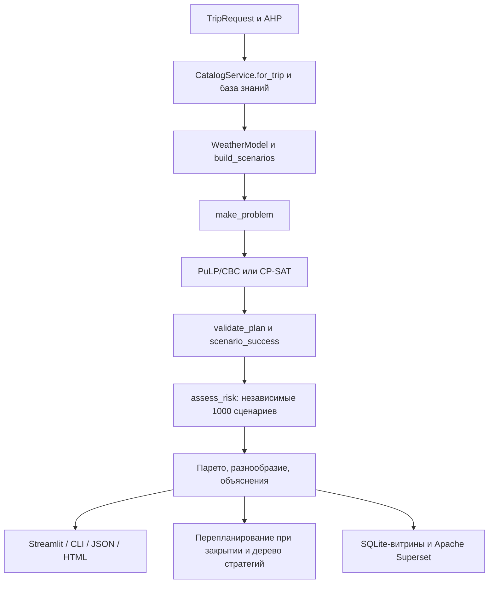

# Внутреннее устройство проекта

Ниже приведены переносимые ссылки на файлы и конкретные определения; якоря строк поддерживаются GitHub, номер строки и имя функции указаны явно. После изменения кода номера строк можно обновить командой `PYTHONPATH=src .venv/bin/python scripts/build_internals_doc.py`.

## Поток данных

## Основные определения

| Код | Назначение |
|---|---|
| [domain.TripRequest](../src/travel_dss/domain.py#L73) (строка 73) | Анкета: даты, бюджет, интересы и жесткие ограничения. Валидация выполняется до поиска. |
| [ahp.analyze_ahp](../src/travel_dss/ahp.py#L29) (строка 29) | Главный собственный вектор, λ, CI/CR; проверка взаимной обратности сравнений. |
| [ahp.aggregate_alternatives](../src/travel_dss/ahp.py#L57) (строка 57) | Учебный AHP-синтез локальных матриц отношений положительных полезностей. |
| [knowledge.KnowledgeBase.infer](../src/travel_dss/knowledge.py#L61) (строка 61) | Прямой продукционный вывод с трассировкой и запретом противоречий. |
| [knowledge.derive_poi_knowledge](../src/travel_dss/knowledge.py#L82) (строка 82) | Факты об объектах и допуск к оптимизации; неизвестные сведения не считаются false. |
| [ontology.export_ontology](../src/travel_dss/ontology.py#L11) (строка 11) | OWL/RDF XML с классами, отношениями, фактами и ограничением подтверждения для Protégé. |
| [catalog_api.CatalogSnapshot](../src/travel_dss/catalog_api.py#L122) (строка 122) | Полный версионируемый контракт источника с проверкой ссылок, календаря, цен и матриц. |
| [catalog_api.CatalogService.for_trip](../src/travel_dss/catalog_api.py#L281) (строка 281) | Выборка по городу/датам, проверка свежести и доступности, разрешение demo только явно. |
| [catalog_api.TripDataset.estimate_cost](../src/travel_dss/catalog_api.py#L258) (строка 258) | Полная смета: дорога, все ночи, питание, трансферы, билеты; диапазоны не называются квантилями. |
| [forecast.WeatherModel.sample](../src/travel_dss/forecast.py#L92) (строка 92) | Совместные последовательные блоки температуры, дождя и ветра из калибровочного периода. |
| [scenarios.build_scenarios](../src/travel_dss/scenarios.py#L45) (строка 45) | Коррелированные цены через общую компоненту Gaussian copula; погода влияет на время переходов и трансферов. |
| [routing.make_problem](../src/travel_dss/routing.py#L139) (строка 139) | Перевод каталога, пакета и предпочтений в конкретную маршрутную задачу, местные минуты и окна. |
| [routing.simulate_day](../src/travel_dss/routing.py#L170) (строка 170) | Независимая последовательная проверка порядка: переход, ожидание окна, посещение, возврат. |
| [routing.check_routes](../src/travel_dss/routing.py#L212) (строка 212) | Проверка состава, уникальности, обязательных/исключенных объектов, обеда и дневных ограничений. |
| [routing.scenario_success](../src/travel_dss/routing.py#L243) (строка 243) | Пакетная проверка совместного события бюджета/времени на сценариях без обращения к решателю. |
| [routing.validate_plan](../src/travel_dss/routing.py#L233) (строка 233) | Повторный расчет номинальной сметы и сценарной выполнимости из исходных данных. |
| [baselines.greedy_routes](../src/travel_dss/baselines.py#L6) (строка 6) | Воспроизводимая вставка объектов с независимой проверкой; начальное решение и baseline эксперимента. |
| [optimization.solve_itinerary](../src/travel_dss/optimization.py#L16) (строка 16) | CP-SAT: выбор посещений, цикл по дням, окна, бюджет, сценарные отказы, линейная полезность. |
| [optimization_pulp.solve_pulp](../src/travel_dss/optimization_pulp.py#L11) (строка 11) | MILP-модель PuLP/CBC: посещения, дуги, MTZ, окна и общие сценарные отказы; экспорт LP/MPS. |
| [routing.candidate_from_routes](../src/travel_dss/routing.py#L279) (строка 279) | Единая независимая сборка и валидация плана из маршрутов PuLP. |
| [preferences.evaluate_criteria](../src/travel_dss/preferences.py#L30) (строка 30) | Единые четыре критерия, фиксированные опоры, насыщение интересов. |
| [preferences.explain_comparison](../src/travel_dss/preferences.py#L49) (строка 49) | Слагаемые разности полезности, которые точно суммируются в разность баллов. |
| [risk.assess_risk](../src/travel_dss/risk.py#L23) (строка 23) | Независимая выборка, C50/C90 полной стоимости, совместная успешность и интервал Уилсона. |
| [decision_analysis.analyze_closure_strategy](../src/travel_dss/decision_analysis.py#L7) (строка 7) | NetworkX-дерево стратегий; SciPy brentq находит порог выгодности подготовленного резерва. |
| [bi.export_bi_database](../src/travel_dss/bi.py#L10) (строка 10) | SQLite-витрины результатов и тестовой истории для настоящего Apache Superset. |
| [recommendation.recommend](../src/travel_dss/recommendation.py#L83) (строка 83) | Проверка всех выбранных городов и пакетов, независимый риск, альтернативы, закрытия и кеш. |
| [recommendation.select_alternatives](../src/travel_dss/recommendation.py#L57) (строка 57) | Парето среди найденных кандидатов, дешевый/удобный варианты, разнообразие по Jaccard. |
| [presentation.export_html](../src/travel_dss/presentation.py#L20) (строка 20) | Экранированный автономный HTML-отчет с расписанием, статьями расходов и параметрами. |
| [presentation.save_feedback](../src/travel_dss/presentation.py#L57) (строка 57) | Локальное параметризованное сохранение выбора в SQLite. |
| [ui.main](../src/travel_dss/ui.py#L130) (строка 130) | Форма Streamlit, запуск поиска и сохранение результата в состоянии сессии. |
| [ui.render_result](../src/travel_dss/ui.py#L40) (строка 40) | Сравнение, сметы, расписание, координатная схема, риски, стресс-проверки и экспорт. |
| [cli.main](../src/travel_dss/cli.py#L133) (строка 133) | Командная точка входа с понятными ошибками вместо traceback для пользовательского ввода. |

## Постановка оптимизации

Для каждой совместимой пары транспорта и жилья строится отдельная задача. Номер 0 — база около жилья; 1…N — реальные объекты; N+1 — обед около базы. В каждом дне `AddCircuit` выбирает один путь от базы с самопетлями для непосещенных объектов. Обед обязателен, каждый объект посещается не более одного раза за поездку, хотя бы один реальный объект обязателен для содержательного маршрута. Ограничения времени и порядковые переменные запрещают подциклы, в том числе на нулевых дугах.

Начало фиксировано политикой дня (09:00 либо позже после приезда/трансфера/заезда), конец ограничен 20:00, дневным лимитом и обратным отправлением. Ожидание учитывается; это может сделать очень короткий день несовместимым с обедом. Политика видна пользователю, а не скрыта в оптимизаторе. Последний день включает выезд из номера до прогулки; отдельное хранение багажа не моделируется.

Расходы округляются вверх до рублей, дуги до минут и метров; тематические доли — до тысячных. Коэффициенты целевой полезности масштабированы на 100 000 000. Экономичность использует среднюю стоимость на плановой выборке, насыщение интересов и клипы реализованы min/max-ограничениями. Публикуемый балл повторно вычисляется исходными функциями с float; малая разница с целочисленной целью отражает округление. Это не другая система предпочтений.

## Сценарные ограничения и проверка

На каждый из 100 сценариев есть бинарное разрешение нарушения z_s; их сумма ограничена допустимой долей отказов. Денежные ограничения добавляются сразу. Временные ограничения добавляются для обнаруженных нарушений: решается релаксация, проверяются все сценарии, добавляются необходимые окна/дуги с тем же z_s. Это позволяет не создавать сразу сотни тысяч временных ограничений. Новое решение принимается только после проверки всех сценариев.

Если релаксация доказанно оптимальна и найденное решение прошло полный набор проверок, оно оптимально и для полной заданной сценарной модели. При лимите возвращается только полностью проверенное допустимое решение (в том числе начальная эвристика), со статусом FEASIBLE. Если оно не найдено — UNKNOWN/INFEASIBLE с причиной. Начальная эвристика не выдается за доказательство оптимальности. Значение цели дополнительно сверяется с присваиваниями; при несовпадении доказательство и gap не публикуются.

Проверочные 1000 сценариев имеют другой seed. Для каждой поездки вычисляется полная стоимость до определения квантилей. Интервал Уилсона относится к успешности по принятой модели; экспертные диапазоны и ошибки сезонного прогноза ограничивают интерпретацию реальных вероятностей. Повторное подбирание seed до удачной проверки не выполняется.

## Рекомендации и резерв

Из всех реально построенных кандидатов удаляются доминируемые по четырем критериям и оценке успешности. Основной вариант максимизирует U, дополнительные показывают более дешевый и более удобный компромисс, если он достаточно отличается. Для одного города требуется Jaccard наборов посещений ≤0.7. Разные города считаются различными. Фронт не объявляется полным Парето-фронтом пространства маршрутов.

Дополнительные задачи минимальной цены и максимального удобства ограничивают потерю полезности δ=0.05. При сравнении разных городов может понадобиться большая уступка; она видна в баллах и разложении. При закрытии объекта создается новый запрос с исключением, затем новый план заново проверяется. Обязательное посещение не отменяется автоматически. У самого события закрытия нет придуманной вероятности.

## Хранение и воспроизводимость

- `data/api/demo_catalog.json` — полный демонстрационный каталог; реальные исходники OSM/ERA5/OSRM лежат отдельно.
- `artifacts/models/` — JSON-параметры обученных прогнозов; pickle не используется.
- `artifacts/recommendations/` — кеш demo-результатов; ключ включает запрос, настройки, код, модели и каталог.
- `data/processed/feedback.sqlite` — локальная обратная связь, без внешней отправки.
- `reports/full_demo.json/html` — сквозной пример; `reports/experiments/` — экспериментальные результаты.
- `tests/test_optimization.py` — точный перебор 20 малых задач и проверка независимого валидатора.
- `tests/test_system.py` — сценарии, сквозной поиск, экспорт и Streamlit AppTest.

## Ограничения и следующие изменения

Фиксированный seed воспроизводит сценарии; поиск без кеша может вернуть другой допустимый план из-за остановки по wall time. Глобальный лимит времени мягкий: построение модели и независимая проверка также требуют времени. В метаданных перечислены неисполненные задачи; скрытого отсева городов или уменьшения каталога нет. Статистические испытания с уменьшенным временем поиска явно записывают этот предел. Междугородние задержки, очереди и неизвестные закрытия не входят в вероятностную модель; закрытия проверяются отдельно. Новые API должны возвращать общий контракт или иметь свой адаптер, а не изменять бизнес-логику решателя.

Чтобы изменить предпочтения — см. preferences.py и масштабированную цель optimization.py вместе; чтобы добавить ограничение — изменяйте и модель, и независимую проверку. Для новых источников сначала расширяется контракт и его тесты. Успешная техническая приемка не заменяет пользовательскую проверку из USER_GUIDE.md.

## Интеграция практик паспорта

AHP валидируется в TripRequest: веса должны совпадать с собственным вектором матрицы и CR≤0.10. В рабочей модели используются абсолютные шкалы; учебный distributive-синтез альтернатив находится отдельно в ahp.py и Excel.

PuLP и CP-SAT получают один RoutingProblem и проходят общий validate_plan. CBC с остановкой по времени может иметь строковый статус Optimal при sol_status IntegerFeasible; решение признается OPTIMAL только по sol_status. Проверенная эвристика сохраняет статус FEASIBLE. LP/MPS экспортирует scripts/passport_evidence.py milp.

KnowledgeBase загружает версионированные правила из data/knowledge/rules.json. recommend использует eligible для передачи объектов решателю, добавляет риск-выводы в карточки и хеширует правила для кеша. OWL-онтология генерируется из каталога; scripts/verify_protege.py проверяет логические следствия HermiT из дистрибутива Protégé. OWL и JSON-правила не объявляются автоматически взаимозаменяемыми.

decision_analysis анализирует только уже проверенный резерв, q берется из сценарной оценки; p закрытия, потеря и стоимость подготовки являются явными предположениями. NetworkX хранит дерево, SciPy находит корень разности EU.

bi/create_dashboard.py создает настоящие объекты Apache Superset; bi/verify_dashboard.py выполняет вход и REST-запросы. scripts/bootstrap_superset.py создает отдельную Python 3.11-среду. scripts/export_bi.py обновляет витрины из выбранного JSON, а scripts/setup_superset.py обновляет метаданные и дашборд. Streamlit содержит ссылку на BI, а не подменяет Superset.

Практическая инструкция: [PASSPORT_TOOLS.md](PASSPORT_TOOLS.md). Аудит: [PASSPORT_AUDIT.md](../reports/PASSPORT_AUDIT.md).
