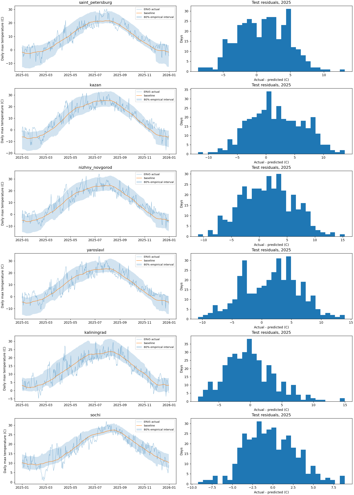

# Карта модели сезонной температуры

Цель — поддержка выбора сезона и направления, не точный метеопрогноз конкретного дня. Показатель — суточный максимум температуры ERA5 в координатах города; единица °C.

Источник: https://open-meteo.com/en/docs/historical-weather-api ; фиксированная модель ERA5, 2015–2025, 24 108 записей. Реанализ не равнозначен прямому измерению городской станции.

## Протокол

Настройка Ridge на расширяющихся окнах: обучение до 2021 → 2022, до 2022 → 2023. Окончательная точечная модель обучается на 2015–2023. Остатки 2024 используются для локальных по сезону 10/90%-квантилей и блоков неопределенности. 2025 — независимый тест. Выбор модели сделан до вычисления тестовых метрик: необходим выигрыш MAE не менее 5% на валидации; диагностическое покрытие калибровки не должно существенно ухудшаться. Калибровочное покрытие является описательной оценкой на тех же остатках, оно не заменяет независимое покрытие 2025 года.

Сезонный день приведен к високосному 2000 году: даты после февраля сопоставимы в високосные и обычные годы. Период гармоник 366 дней — небольшое уточнение исходной формулы 365.25 для согласования с этой календарной шкалой; тренд измеряется в годах по 365.25 дней.

## Независимый тест 2025

| Город | Модель | MAE, °C | Покрытие интервала 80% | Средняя ширина, °C | Skill Ridge к baseline |
|---|---|---:|---:|---:|---:|
| Санкт-Петербург | baseline | 3.105 | 78.9% | 11.29 | +1.5% |
| Казань | baseline | 3.971 | 77.5% | 13.26 | +3.5% |
| Нижний Новгород | baseline | 3.982 | 77.8% | 13.16 | +2.5% |
| Ярославль | baseline | 4.136 | 68.5% | 12.37 | +3.0% |
| Калининград | baseline | 3.035 | 74.5% | 10.27 | -2.5% |
| Сочи | baseline | 2.566 | 61.6% | 6.53 | +0.5% |

Ridge нигде не достигает порога 5% на валидации; выбрана обученная сезонная baseline. Это выбор по эксперименту, а не предположение о превосходстве сложной модели.

**Ограничение калибровки:** в Ярославле и особенно Сочи интервалы на тесте заметно недопокрывают номинальные 80%. Даже в других городах покрытие не гарантируется на новых датах. Вероятности погодного комфорта — эмпирические доли сценариев; нельзя использовать их как гарантированные вероятности. Нельзя расширять интервалы по тестовому 2025 году и затем называть результат независимым. Улучшение потребует нового протокола с отдельным последующим тестом.

Блоки длиной поездки сохраняют последовательность остатков температуры, осадков и ветра из одного фрагмента 2024 года. Используется сезонный радиус 45 дней; число доступных блоков невелико, редкие экстремумы могут быть представлены недостаточно.

Модель фиксируется на периодах плана и не дообучается на 2025 после тестирования. Для рабочих прогнозов 2027 года требуется отдельное дообучение с новой калибровкой и сохранением исходного оценочного эксперимента. Текущий CLI честно возвращает сезонную оценку.

Артефакты безопасно сериализованы в JSON (без pickle); сохраняются параметры и калибровочные остатки. Источник, даты получения и SHA256 файлов данных находятся рядом с CSV.

Подробные метрики по зиме/весне/лету/осени и сетка настройки: metrics.json.
